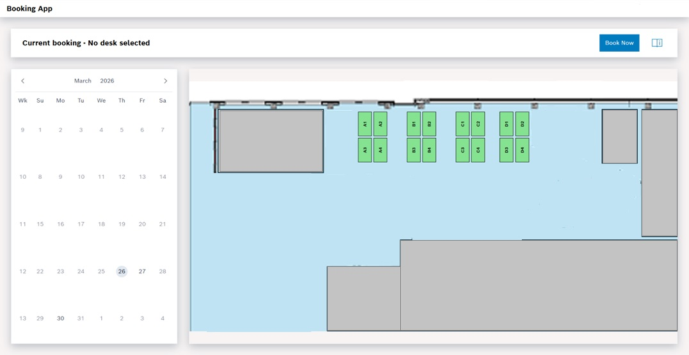
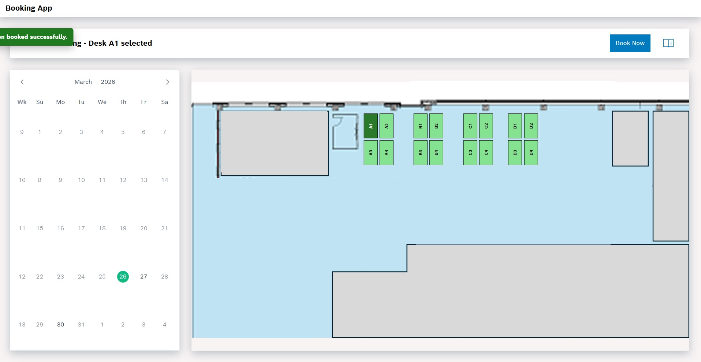
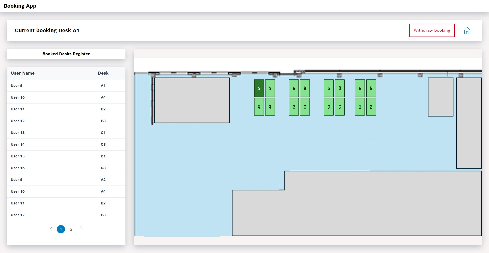

# Desk Booking App

A web application for booking office desks. Users can select a date, view available desks on an interactive office map and make a reservation.
This repository contains the Angular frontend and part of the PHP backend.
The complete backend and internal databases are not included. The full application cannot be run from this repository alone.
The screenshots show the application's interface and main booking flow.

## Imagies

### Desk selection

### Booking confirmation

### Booked desks register

## Features

- Interactive office map with desk selection
- Calendar-based date selection
- Desk reservation flow
- Booking confirmation popup
- Details of booked desks
- Responsive user interface

## Technologies

| Part | Technologies |
| --- | --- |
| Frontend | Angular, TypeScript, HTML, SCSS |
| Backend | PHP |

## Project Structure

| Folder | Description |
| --- | --- |
| `frontend/` | Angular frontend application |
| `backend/` | PHP backend code |
| `images/` | Screenshots used in the documentation |
